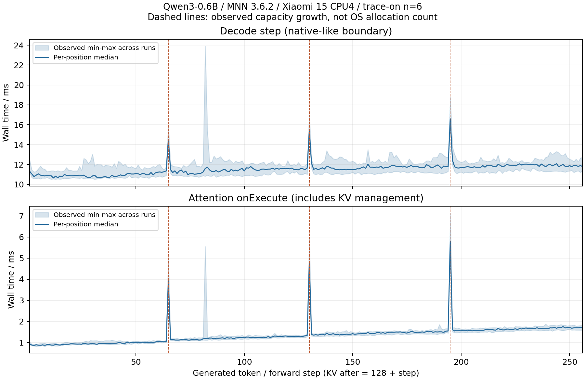

# Gate 2-A｜MNN Android LLM Decode执行机制研究

本次完成真实源码追踪、独立分支的缓冲式逐Token插桩、正确性对照、Tracing开销评估及36次控制运行。**观察到的Decode成本变化与增长的历史KV读取、周期性容量扩展相符；尚未发现值得立即修改的Runtime缺陷。本阶段不进入Runtime改进。**

这不是“差异全部由KV造成”的排他性结论。设备频率上限变化、线程调度与进程间热状态仍有混杂；没有将跨进程相关性称为因果关系，也没有实现加速。

报告生成UTC：2026-11-08T15:36:08.928342+00:00。所有数值由 `scripts/write_report.py` 从原始样本派生；分析入口为 `analysis/summary.json`、`samples.csv`、`segments.csv`、`paired.csv`、`growth-events.csv`。源码引用详见[调用链与源码引用](调用链与源码引用.md)。

## 1. 研究边界与固定资产

- MNN 3.6.2，基底 `7e3c6fb5225d3ccf22807ee641332669df34650d`。干净worktree `/home/shawrange/src/MNN-3.6.2`；诊断worktree `/home/shawrange/src/MNN-decode-gate2a`、分支 `diagnostic/decode-gate2a`。诊断修改未提交，版本由基底+完整补丁+源码快照+产物哈希精确定义。
- 模型Qwen3-0.6B-MNN，revision `34dfccda1187ded6e07ea06426da576b0b793c6b`；权重SHA256 `953afb7e0165818add34a7a6caf0af5d0ed9428da102eb22c9b98ee9da292e9f`。复用既有模型，未重导出；发布者未公开的导出细节仍未知。
- 小米15 / serial ee19377b / SM8750 / Android16 API36 / arm64-v8a / 4KiB页。Windows ADB、WSL Ubuntu、Linux NDK r27c/Clang18.0.3、CMake4.2.3/Ninja1.13.2。
- CPU4、precision2、memory2、power0、greedy、ignore_eos=true、async=false、reuse_kv=false、mmap0、qa0/fa1；始终128输入，requested/effective dynamic_option均为0。chunk保持默认0，没有更换有效Runtime模式。
- Release/C++17/c++_static、SEP_BUILD OFF、ARM82 ON、SME2/KleidiAI/GPU/NPU OFF；诊断构建仅增加 `-DMNN_GATE2_TRACE` 与保存的scope补丁。实际cache、configure/build/exit/readelf在 `evidence/build/`。
- 独立远端目录 `/data/local/tmp/mnn-gate0-20261108T134731469951Z/gate2a-diagnostic`。三个模式使用显式LD_LIBRARY_PATH；两个官方llm_bench哈希相同，变化在libMNN.so。诊断库SHA256 `0985d00f7abd7261d94bee16de7a3e88064f78b426093f7411f355caea8daf83`。
- Gate1原有1894个文件哈希均未改变，Gate0三项基线二进制及原源码保持干净；最终手机模型/库/CLI哈希与本机一致。见[verification-summary.json](verification-summary.json)。该通过字段是本研究证据完整性检查，不是完整Runtime回归测试。

## 2. Gate1复核：差异可重复，不能单独归因

直接复核50个原始sample/Benchmark JSON与samples.csv，50/50成功且关键值一致。未改写任何原样本。128+64与128+256分别10个样本；原Decode中位数91.53与85.58 tok/s。

10个随机区组中长生成全部更慢；同区组 `(长TPS/短TPS−1)×100%` 的中位数 -6.397%，范围 -14.832%–-0.836%。短先跑7次、长先跑3次，两种顺序方向一致。探索性双侧符号检验p=0.001953125，依赖区组符号独立/可交换假设；单设备时间相关性限制其推断范围，不能转述为因果检验。

长生成在区组 [1, 2, 4, 5, 6, 8] 启动时skin更低，仍更慢；这反对“仅由更高起始skin温度解释全部差异”的简单说法，不排除运行中热变化、频率或调度。

整进程非自愿上下文切换：短中位117.0、范围38–3331；长中位1362.5、范围38–20492。长进程本来运行更久，计数还包括load/tuning/warmup，因此不能用此差异证明Decode被抢占。端点policy0/policy6的当前频率和上限均有变化；thermal status=0不能证明锁频。原记录没有Decode阶段调度/频率驻留Trace。

两负载的计时定义、有效dynamic_option与参数一致，适合比较**各自整个Decode区间的平均成本**；它们覆盖的KV长度区间不同，不能视为同样上下文的单Token性能。现有Gate1不能给出逐Token曲线、扩容贡献、纯Attention成本，不能断言内存带宽瓶颈或Runtime Bug。详细逐区组数值和状态见 `evidence/gate1-audit/paired-review.csv`、`paired-states.csv`。

## 3. 执行机制与指标定义

真实连接：`llm_bench main` → `Llm::response` → `generate_init` → `Llm::generate(vector/VARP)` → Prefill `forwardVec` → `ArGeneration::generate` → 每Token `forwardVec(vector)` → embedding/mask/position → `forwardRaw` → Module/StaticModule → Session/Pipeline → `CPUAttention::onExecute` → `CPUKVCacheManager`。完整函数及行号以[源码说明](调用链与源码引用.md)为准；关键入口如下：

- `llm.cpp:1150–1157`：Prefill Timer包含forwardVec/updateContext，输入embedding在外，gc在后。`1221`进入生成策略。
- `speculative_decoding/generate.cpp:63–109`：采样并追加history/output、更新gen_seq_len、检查停止后，`:86–109`才计Decode；覆盖tokenizer_decode、字符串维护、单Token forward和all_seq_len更新；没有输出stream。prefill logits产生首个token，N个输出仍有N次forward，最后一次logits未再采样。
- `llm.cpp:732–754,592–651,708`：单Token embedding、KVMeta.add=1、mask/position、onForward/readMap/wait和KVMeta.sync均在Decode Timer内。`source/core/KVMeta.hpp:52–63`把previous按remove/add/reserve更新并清标志；本配置每步+1。
- `CPUAttention.cpp:435–450`：新response清KV并onAlloc，否则onRealloc，再onUpdateKV。`CPUKVCacheManager.cpp:403,512–557,1027–1072`：初始capacity=输入+64，只有所需长度>capacity才扩容，每步追加新KV。
- `CPUAttention.cpp:490–496,825,931–956,1059–1091,1116–1141,1234–1338`：读取有效kvSeqLen，遍历历史K/V块，执行QK、softmax、PV。只追加一个Token不代表只读一个Token的历史。Flash block/GQA减小部分中间开销，未消除历史KV读取。

原JSON TPS是Token数/原生阶段微秒；多重复时先各次算TPS再均值，本次rep1只有一个有效样本。原Timer使用gettimeofday，诊断另用CLOCK_MONOTONIC，未替换原计时。**不是TTFT**，没有测单请求纯用户延迟；RSS仅取整进程time -v，MemAvailable是系统值，未测逐Token PSS或独占KV字节。

## 4. 诊断实现及正确性

现有getCurrentHistory能读逻辑KV；逐次generate(1)会改变原循环调用形态。官方BenchProfile/公开op callbacks可用steady_clock聚合op，但不提供逐Token KV容量/扩容。故在独立分支增加最小scope；没有改动输入、算式、权重、采样、KV分配策略、调度或原计时器。

`evidence/diagnostic.patch`仅含新 `include/MNN/Gate2Trace.hpp`、AR循环、CPUAttention入口与KV三个函数的观测scope。宏关闭时不编译这些scope；诊断版以环境变量prefix决定开关，正常基线库从未替换。

固定8192步骤/8192事件缓冲，只在进程正常退出时统一写CSV；热路径无Trace文件/打印/容器分配。函数内static初始化避免全局动态STL初始化。Token记录序号、Token ID、逻辑KV前后、单调时钟墙钟与调用线程CPU时钟；Attention scope覆盖同步父调用（含worker等待），KV scope分别累计alloc/realloc/update；容量变化另记manager、past、capacity、inDisk。仅支持本实验单同步请求，不能当作并发产品Tracing接口。

独立public API功能驱动 `scripts/correctness.cpp` 同样CPU4/Low/有效dyo0：clean/off/on分别执行合成128输入和自然语言输入，均生成256token。两种输入各自三个模式的**完整Token IDs、文本字节、最终status/prompt/gen/KV元数据完全相等**。合成KV=384，自然输入43token、最终KV=299，终态均MAX_TOKENS_FINISHED。自然文本包含thinking且因256上限截断；验证目标是插桩前后结果一致，不宣称答案完整或建立了通用模型质量评测。原文、Token列表与退出码在 `results\correctness-20261108T151138Z-ac575c`。

这覆盖了本实验的KV跨界和自然文本路径；没有运行完整op数值/多线程/跨后端测试矩阵，未改数值kernel也未作全面回归声明。

## 5. 实验协议、成功样本和整体性能

先完成6次功能运行，再2次trace pilot，均成功；不与控制样本混池。随后6区组，每区组clean/off/on×64/256，seed=20261109洗牌，合计36/36成功，无失败、无速度删点。clean/off属于无Tracing性能对照，on属于诊断；均新进程warmup1+有效1。每种模式每负载n=6。实验时间UTC `2026-11-08T15:14:55.805358+00:00` 至 `2026-11-08T15:26:19.347560+00:00`。

最短间隔12秒，要求skin<=38、电池<=36、当前HAL CPU最高<=80°C、thermal status=0；超限额外等待，不锁频/不固定核亲和、不改系统安全设置。实际冷却中位12.32秒、范围12.27–27.72秒。所有模式使用同一低频observer；state前后各采一次，原始stdout/stderr/exit/命令/时间/JSON均保存。官方JSON保留未改写。

单位tok/s；范围是进程样本min–max，SD为n−1样本标准差。

|模式|输入+生成|n|Decode均值|Decode中位|Decode范围|Decode SD|Prefill中位|
|---|---|---|---|---|---|---|---|
|干净基线库|128+64|6|92.29|92.32|90.75–94.27|1.18|347.56|
|干净基线库|128+256|6|86.59|86.78|83.88–89.04|1.97|345.96|
|诊断库 Trace关闭|128+64|6|91.90|91.01|90.73–94.46|1.60|536.52|
|诊断库 Trace关闭|128+256|6|86.15|85.97|83.23–90.04|2.93|411.04|
|诊断库 Trace开启|128+64|6|92.13|92.13|90.96–93.80|1.00|347.17|
|诊断库 Trace开启|128+256|6|86.42|86.45|82.11–89.75|2.57|345.68|

同区组长/短吞吐变化：

|模式|配对数|配对变化中位|配对变化范围|
|---|---|---|---|
|clean|6|-6.528%|-8.091%–-3.583%|
|off|6|-6.735%|-8.586%–-2.623%|
|on|6|-5.686%|-10.051%–-4.321%|

三个模式均6/6方向为负。当前clean中位92.32/86.78与Gate1绝对值不同；会话热状态、调度、observer和时间都不同，**不将两会话混池、不称性能改善**。n=6只用于机制复核与扰动量级，不能据P95或单次数据声称稳定。

## 6. 单次长生成内部的分段成本

每个单元先在每进程内对64步取均值，再报告6进程中位[min–max]，单位ms/Token；不把1536个Token当作1536个独立设备样本。KV列是各步forward完成后的实际逻辑长度；Attention为28层总墙钟，已包含KV函数。

|步序|KV after区间|步骤墙钟|Attention|其余步骤成本|realloc中位|Attention占比中位|
|---|---|---|---|---|---|---|
|1–64|129–192|10.87 [10.80–11.64]|0.95 [0.93–1.03]|9.92 [9.86–10.61]|0.002|8.71%|
|65–128|193–256|11.55 [11.06–12.13]|1.29 [1.21–1.34]|10.25 [9.85–10.79]|0.049|11.03%|
|129–192|257–320|11.82 [11.26–12.35]|1.49 [1.42–1.59]|10.32 [9.84–10.76]|0.059|12.73%|
|193–256|321–384|11.94 [11.45–12.59]|1.70 [1.61–1.81]|10.24 [9.84–10.78]|0.071|14.28%|

同一次长生成“末64−首64”的配对均值差：步骤墙钟中位0.831ms，范围0.518–1.343；Attention中位0.735ms、范围0.664–0.836，6/6均增加。非Attention部分中位增加0.096ms、范围-0.149–0.507，变化不完全同向。

从Attention中减去已测alloc/realloc/update后，末段仍比首段增加中位0.622ms，6/6为正；删去65/130/195三个扩容步骤的分段均值也保存在segments.csv。扩容并非全部增长的解释。这个残差含pack、scratch、QK/softmax/PV、线程等待和观测开销，不能直接称“纯Attention Kernel时间”。

6对on短/长运行的前64Token ID全部一致，因此没有发现“长生成请求改变了前缀Token内容”的现象；后续Token内容和KV长度同时变化。当前Synthetic固定token16输入，生成文本不代表自然任务分布。

图中每个位置聚合6进程，带宽为观测min–max，不是置信区间；不平滑、不剔除尖峰。绘图数据为token-aggregates.csv，SVG和脚本一并保存。

## 7. 实际容量扩展与局部尖峰

长生成每个response均在65/130/195步，28个manager在同一步出现capacity变化；短生成无Decode容量变化。所有事件inDisk=0。新增Token时的past/容量与源码预测一致；没有将每次onRealloc调用误计成扩容。

|步骤|capacity变化|每response manager数|28层realloc总ms|该步总ms|相邻步骤中位ms|
|---|---|---|---|---|---|
|65|192→257|28|2.98 [2.88–3.99]|14.52 [14.09–15.84]|11.30 [10.93–11.77]|
|130|257→322|28|3.60 [3.38–4.70]|15.46 [14.95–17.02]|11.57 [11.06–11.93]|
|195|322→387|28|4.38 [4.15–5.60]|16.60 [16.10–18.79]|11.75 [11.24–12.82]|

三次增长步骤的realloc scope总和占整段长Decode墙钟中位0.370%、范围0.364–0.458%。它们解释了固定位置的局部尖峰，但所测占比不足以单独解释约6%的长短吞吐差异。此占比不是保证可消除的成本或可实现加速率；scope仍含必需拷贝/分配及等待，未统计OS分配次数或memcpy字节。短生成只达到KV192，没有越过初始capacity192。

控制Trace共3840步（含warmup）和1008条manager增长事件，dropped=0。每步Attention_count=KV_update_count=28，kv_before=127+步序、kv_after=128+步序。有效测量选择response2，response1单独保存。Trace步墙钟总和与原生decode_us最大绝对差0.026547ms，说明边界核对一致；**不代表Tracing开销为零**。

## 8. Tracing开销评估

同区组、同生成长度，用 `(对照TPS/观测TPS−1)×100%` 表示耗时变化；正为观测更慢。on/off使用同一诊断库，clean/off还包含编译布局、额外getter/scope与缓冲驻留差异。原生JSON不计Token scope开始/结束的全部额外工作，因此同时列出stdout wall proxy：response wall−native prefill（含采样及prefill计时外工作，不是纯Decode）。

|生成长度|对照→观测|原生耗时变化中位[min–max]|wall proxy变化中位[min–max]|
|---|---|---|---|
|64|off→on|-0.205 [-1.613–1.354]%|-0.176 [-1.603–1.392]%|
|64|clean→off|0.377 [-1.090–1.719]%|0.380 [-1.115–1.695]%|
|256|off→on|-0.008 [-3.077–1.631]%|-0.037 [-3.137–1.645]%|
|256|clean→off|1.207 [-2.043–2.478]%|1.268 [-2.024–2.494]%|

差值有正有负，量级与跨进程波动重叠；本实验没有分辨出稳定的正向Tracing开销，**不能声称零开销、负开销或Tracing加速**。off/on未隔离温度/频率/worker调度的全部差别，也没有用原生时间相近去替代开关对照。写CSV在进程退出阶段，影响整进程wall但在阶段计时外。

整进程MaxRSS中位：clean 904.05MiB、off 904.50MiB、on 904.14MiB；诊断固定缓冲约1MiB，不能把差异误归因模型KV架构。PSS未测。主要机制结论来自重复的KV状态/事件位置和较大的分段成本变化，不把亚百分点差异当作精确结论。

## 9. 设备状态、异常与剩余混杂

- 72个前后快照：skin 32.227–37.903°C，电池 30.400–34.700°C，HAL CPU最高 34.9–69.6°C；thermal status均0，USB充电均true，Wakefulness均Dozing。没有把Dozing等同CPU固定运行状态。
- 系统MemAvailable 7594152–8187512KiB。未见本实验失败/OOM，不能据此断言所有分配均无页错误或内存压力。
- policy0前后上限 [2400000, 2745600]kHz；policy6 [1958400, 2246400, 2438400, 2649600, 2841600]kHz。频率上限及采样当前频率随会话变化，前期到后期吞吐也漂移，不视为锁频稳态。
- 低频observer共318个tick，实际间隔中位0.63秒、范围0.58–0.69秒（sleep0.5再加命令读取开销），可读取各policy及进程/线程schedstat、上下文切换。完整raw为每次device-timeline.txt，解析副本在analysis/timelines。observer扰动未独立量化，三模式均开启；不与Gate1绝对TPS直接合并。
- `/proc/uptime`可能含suspend时间，Trace使用CLOCK_MONOTONIC；未采集同步offset，所以没有做Token到频率或调度样本的精确对齐。温度只有前后HAL快照，单个sysfs thermal_zone0读取可用但未确认传感器类型，不把它冒充逐Token CPU温度。没有PMU带宽、逐Token线程迁移/全核有效频率或精确CPU功耗证据。
- 本轮整进程非自愿上下文切换中位（短/长）：clean 51.0/95.5；off 142.0/318.5；on 138.0/119.5，没有统一的长短计数方向，且生命周期不同，不能作为排除/确认调度因素的因果证据。所有原计数保存在samples.csv与time stderr。
- 最大有效Token墙钟为23.930ms，位于 `results\control-20261108T151455Z-f42f6b\008-b02-on-tg256` 第82步；Attention 5.549ms、realloc 0.002604ms、调用线程CPU 23.835ms。这不是容量增长步骤，保留未删。主线程CPU接近wall不支持“主线程长时间被挂起”的简单解释，但worker抢占/忙等、频率和其他瞬态仍未排除，未标成Runtime Bug。
- 本轮无权限拒绝阻止已用指标读取；未尝试root、安全设置或内核perf提权。缺失指标是本实验没有可靠采集/对齐，不伪称已测。没有从整进程上下文切换推导Decode因果结论。

## 10. 根因候选与下一阶段决策

见[根因候选与证据边界](根因候选与证据边界.md)，最多三个候选。当前证据足以解释主要执行机制和固定扩容尖峰，尚不足以把全部长短差异分解成唯一原因，也未证实任何异常数学/缓存重用行为。

**决策：Gate2-A完成；暂不进入Runtime源码改进。** 先将“历史KV增长的预期Attention成本”作为当前最符合证据的解释，将设备状态列为剩余混杂；周期扩容占比较小，不据此设计新KV架构。若继续研究，优先做时钟对齐与更细的控制实验；只有测出可重复、可隔离且值得维护的问题后再讨论源码改动。没有加速收益声明。

## 11. 复核与复现入口

- [运行与复现说明](README.md)、[实验前协议](diagnostic-design.md)、[源码调用链](调用链与源码引用.md)。
- `scripts/run_experiments.py`、复制复用的Gate1标准库ADB/状态工具 `scripts/gate1_runner.py`、设备低频observer `scripts/monitor.sh`。
- `scripts/analyze.py`从每次原始JSON/Trace/状态读取，未读取手工填充的性能表；`scripts/plot_trace.py`输出图及逐位置聚合CSV；`scripts/write_report.py`产生本报告。
- 每次结果都有session protocol/schedule/runner快照，stdout/stderr/exit/command时间、before/after/cooling、原始JSON与可用Trace。首次失败即停止，未使用任何按速度过滤。
- 本次protocol.json的scope文本继承了复用工具的Gate1标签；实际phase、schedule、command与目录均为Gate2，原记录未改。`experiment-config.json`明确此标签更正；未来runner已改为Gate2 scope，不影响任何测量值。
- 最后执行 `scripts/verify_evidence.py`，核对旧Gate1哈希、干净基底、补丁可应用性、live diff、设备模型/二进制哈希与样本计数，并生成 `artifact-manifest.sha256.json`。补丁通过git apply --check与diff --check；所有测试结论均来自实际运行。
