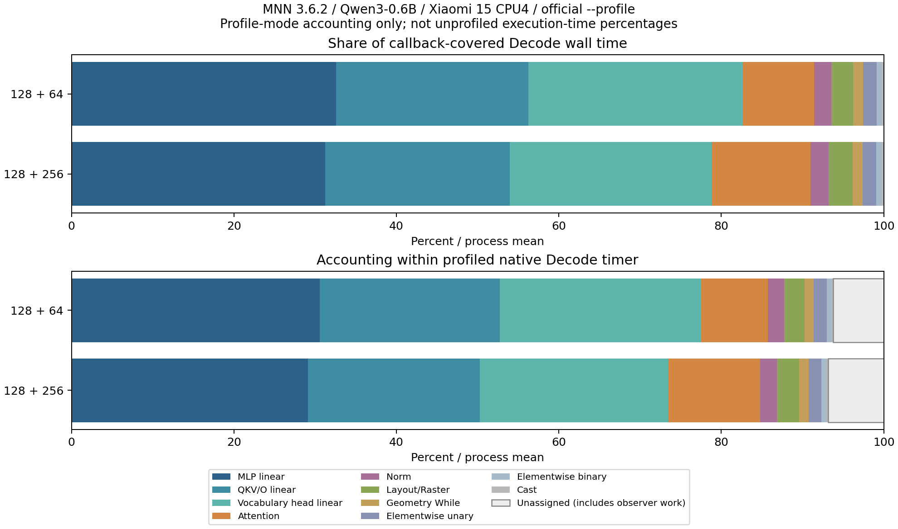

# Gate 2-B｜MNN Android LLM Decode热点归因报告

**本轮完成可信热点归因；不建议进入当前配置的Runtime源码优化阶段。建议结束当前CPU性能优化选题，下一阶段另立移动端GPU/NPU实际执行路径研究，本轮未执行GPU/NPU。**

主要执行时间落在量化线性投影：官方诊断中，Convolution线性投影占回调覆盖时间中位 82.82%（128+64）和 78.57%（128+256）。它们包括MLP、Q/K/V/O和8bit词表头。当前没有证据证明其中存在值得安全局部修改的实现缺陷；也没有PMU/roofline证据把必要计算判为低效。

以上占比来自**开启Profiling的诊断模式**，不直接搬移为无Profiling运行中的精确时间占比。对Gate2-A“Attention之外86%–91%”的解释是定位到这些具体计算类别，不能把那一大段统称为Runtime调度开销。

报告生成UTC：2026-11-08T19:38:45.699629+00:00。所有表由 `scripts/write_report.py` 从analysis JSON/CSV生成，分析脚本直接读取原始JSON/PROF/Trace/状态。

## 1. 固定配置与保护边界

- MNN3.6.2 commit `7e3c6fb5225d3ccf22807ee641332669df34650d`；模型revision `34dfccda1187ded6e07ea06426da576b0b793c6b`；权重SHA256 `953afb7e0165818add34a7a6caf0af5d0ed9428da102eb22c9b98ee9da292e9f`。
- 小米15 / SM8750 / Android16 API36 / ARM64 / 4KiB页，serial ee19377b；Windows ADB + WSL Ubuntu/Linux NDK r27c/Clang18。沿用Gate0的Release/c++_static/ARM82 ON、SME2/KleidiAI及GPU/NPU OFF二进制。
- CPU4、Low precision/memory、power normal、qa0/fa1、mmap0、async=false、greedy、ignore_eos、reuse_kv=false。输入128；两个负载有效dynamic_option均0，未通过改变模式获得速度差异。
- 本轮不重编译或修改Runtime；官方CLI和lib均为Gate0干净产物。补充op_probe只使用public API及debug callback，链接同一干净lib，不使用Gate2-A插桩库。
- 新远端目录 `/data/local/tmp/mnn-gate2b-20261108`；原模型目录只读复用。每个会话核对设备端模型/配置/库/CLI/probe与本机SHA256。
- 预先保存Gate0、Gate1、Gate2-A共3915个原文件哈希；最终核对见 `verification-summary.json`。干净源码和Gate2-A诊断分支差异也独立核对。没有修改这些阶段的任何原始证据。

## 2. 源码核查：已有工具能做什么

真实实现为 `llm_bench.cpp:1201–1270` 的BenchProfile，安装位置`:1330–1340`。它用steady_clock，在同一次-pg请求内按gen_seq_len分Prefill/Decode、按type/name聚合calls与total_us。warmup回调不计数，仅i>0 active。仓库技能文档描述旧版通用Profiler输出；本研究以固定提交实际代码为准。

- 本模型没有单独的MatMul类型行：已观测的197个1×1 Convolution代表线性投影；Attention内部QK/PV也不会单列为MatMul。没有把“表里没有MatMul”解释成没有矩阵计算。
- MLP不是一个单独op enum。本报告用真实节点名及原图分出84个MLP**线性投影**，其激活/乘法仍在Unary/Binary类别；不是完整MLP模块计时。
- Norm、Attention、Raster、While、Unary/Binary、Cast均可直接按类型分开。源码路径、函数和行号详见[方法与源码映射](Profiling方法与源码映射.md)。
- 回调包围Execution::onExecute及output wait；在外的map/string/shape统计、Module/Session/Pipeline管理未全部进入op sum。CPU内部并行用父调用墙钟，不相加worker CPU时间。
- Pipeline callback不覆盖所有Runtime管理；While/Attention等内部子工作被包含，不能再次相加。补充工具实测nested=foreign=0，支持本模型同步单请求的无嵌套统计，不推广为任意并发后端安全。
- 官方只给每节点累计耗时，不能直接给单调用P95。故新增约百行public API补充工具，缓冲每次调用后统一写文件；没有开发新的Runtime Tracing框架或上游补丁。

## 3. 真实模型图与工作量

只读FlatBuffer verifier通过，解析原图3275个静态节点，输出在 `evidence/model/graph-detailed.tsv`。静态节点数不等于优化/lower后的每Token运行command数。

|实际线性组|次数/Token|图中维度|量化属性|
|---|---|---|---|
|Q/K/V/O|28×4=112|Q:1024→2048；K/V:1024→1024；O:2048→1024|aMaxOrBits=4|
|MLP gate/up/down|28×3=84|gate/up:1024→3072；down:3072→1024|aMaxOrBits=4|
|lm_head|1|1024→151936|aMaxOrBits=8|

全部为1×1 Convolution，模型图及callback名称一一可核对。词表头与层内投影位宽不同，不能用一个统一的“4bit模型带宽”口径推算效率。外部权重段/量化元数据、cache、动态输入量化、postprocess等都影响实际流量；本轮没有虚构DRAM有效GB/s或硬件上限比例。

## 4. 实验组成与功能验证

- 最终功能对照：合成128输入、自然文本43输入，各off/detail生成256 Token，4次native运行全部退出0；完整Token ID、文本字节和最终status/prompt/gen/KV一致，Token SHA256也与Gate2-A一致。合成最终KV384，自然最终KV299，均到MAX_TOKENS_FINISHED。文本包含thinking且受长度上限截断；验证目标为观测不改变结果，不是答案完整性或通用模型精度评测。
- 官方pilot：2/2成功，不混入正式池。
- 官方正式：6随机区组，off/profile×两负载，共24/24成功；每组每模式n=6，rep1，即1次warmup+1次有效。seed20261110；原始schedule保存。会话 `official-20261108T192212Z-563373`，UTC `2026-11-08T19:22:12.169465+00:00` 至 `2026-11-08T19:30:19.525667+00:00`。
- 补充诊断：2随机区组，off/detail×两负载，8/8成功；每组每模式n=2，warmup1+有效1，seed20261111。会话 `detail-20261108T193019Z-e977c9`，单独分析、不与官方池混合。
- 最短间隔12秒，skin<=38、电池<=36、HAL CPU最高<=80°C、thermal status0才开始；实际冷却中位12.28秒、范围12.22–27.66秒。超限多等待，不锁频、不绑核、不改系统安全机制。
- 每次保存原stdout/stderr/exit/命令/UTC开始结束/Benchmark JSON或probe summary、前后状态、cooling检查和原始设备时间线。没有按速度删样本。所有模式同一observer。

### 正式计时分布

单位tok/s，最后一列为中位[min–max]；n为独立进程，native阶段计时定义与Gate2-A相同。官方与补充工具横向绝对值受不同执行/观测方式影响，只在各自off/on配对内评估扰动。

|工具|模式|负载|n|Decode均值|Decode中位[范围]|
|---|---|---|---|---|---|
|official|off|128+64|6|91.60|91.77 [90.56–92.16]|
|official|off|128+256|6|83.27|82.79 [81.46–86.67]|
|official|profile|128+64|6|85.75|85.62 [83.58–88.03]|
|official|profile|128+256|6|79.19|78.89 [75.79–85.00]|
|detail|off|128+64|2|91.03|91.03 [89.49–92.57]|
|detail|off|128+256|2|84.27|84.27 [83.90–84.64]|
|detail|detail|128+64|2|89.86|89.86 [88.43–91.30]|
|detail|detail|128+256|2|82.04|82.04 [81.99–82.08]|

n=6不足以证明尾部稳定；n=2更不能据P95给稳定性保证。没有将任何一次profile绝对TPS当作无profile性能，也不与Gate1/Gate2-A跨会话值混池作收益声明。

## 5. 官方Profiling开销

同区组同长度，`(offTPS/onTPS−1)×100%`为观测到的耗时增加。原生Decode不含全部采样/初始化工作，所以另列wall proxy：response wall−native prefill；后者含采样和prefill计时外工作，不能叫纯Decode wall。

|开启方式|生成长度|配对数|native耗时变化中位[范围]|wall proxy变化中位[范围]|
|---|---|---|---|---|
|profile|64|6|6.978 [2.881–10.095]%|6.936 [2.843–10.205]%|
|profile|256|6|4.335 [1.964–8.885]%|4.317 [1.861–8.950]%|
|detail|64|2|1.299 [1.200–1.398]%|1.244 [1.092–1.397]%|
|detail|256|2|2.724 [2.329–3.119]%|2.773 [2.349–3.198]%|

官方12个配对均更慢；观察到的相对成本还包含debug执行路径、map/string/shape统计、wait与时钟等，不是单次读时钟成本。独立进程热/调度漂移仍存在，不将该表解释为精确孤立因果常数。补充模式仅2配对且随机顺序未保证每个条件反平衡，1–3%左右的观测差不能推广为通用开销上限。

官方与补充方法的开销不同；主热点排序/语义用官方结果，单调用分布用补充结果，绝不混作同一池。进程退出时写CSV也影响整进程wall/IO，但不进入native Decode阶段时间。

## 6. 主要热点构成

每格先对单进程总op时间除以生成Token数，再取6进程中位[min–max]；份额分母为**callback覆盖的op总墙钟**。类别之间无重复，Attention包含KV等内部工作。次数由原始PROF验证，所有正式profile进程一致。

|类别|调用/Token|64生成 ms/Token|64生成占op总时间|256生成 ms/Token|256生成占op总时间|
|---|---|---|---|---|---|
|MLP线性投影|84|3.575 [3.471–3.639]|32.66%|3.721 [3.513–3.814]|31.31%|
|Q/K/V/O线性投影|112|2.612 [2.512–2.617]|23.73%|2.724 [2.559–2.758]|22.78%|
|8bit词表头|1|2.896 [2.824–2.913]|26.33%|2.921 [2.793–3.044]|24.87%|
|Attention整体|28|0.958 [0.940–0.981]|8.75%|1.443 [1.324–1.530]|12.04%|
|Norm|113|0.230 [0.223–0.273]|2.10%|0.266 [0.223–0.310]|2.26%|
|Raster/布局|454|0.280 [0.264–0.377]|2.56%|0.355 [0.273–0.409]|2.97%|
|While/geometry|112|0.130 [0.120–0.142]|1.18%|0.147 [0.124–0.168]|1.25%|
|Unary|86|0.188 [0.175–0.193]|1.73%|0.197 [0.182–0.212]|1.65%|
|Binary|141|0.063 [0.057–0.081]|0.57%|0.076 [0.060–0.093]|0.63%|
|Cast|57|0.026 [0.025–0.039]|0.24%|0.034 [0.027–0.040]|0.28%|

这里的MLP/QKV/O/词表头合计197个Convolution/Token。其他类型依次为Attention28、LayerNorm113、Raster454、While112、Unary86、Binary141、Cast57，共**1188个callback command/Token**。每个官方profile有效Decode有1188个命名记录，各节点calls等于生成长度；name=*是类型汇总，不重复计入。

图按进程份额求均值，表用中位数；图的类别和为100%，不是未profile基线占比。下图部分以native Decode为分母，另显式保留未归属时间。

## 7. 单调用分布与Runtime残差

补充工具每进程保存所有调用的id/token/start_ns/ns及meta；有效Decode共760320条调用，零duration共111条、全部保留。四次detail均无丢失、无嵌套、无跨线程callback，稳态new_metadata_measured=0；Record缓冲500000条，未发生热路径扩容或文件输出。

下表为256生成的两个诊断进程。中位耗时列取两个进程各自单调用中位的中位，P95列给各进程内部描述性P95范围；不是两个进程的尾部延迟保证，更不是用户请求P95。单位μs，完整1190个meta及节点/类型分布保留在raw和analysis中。

|节点|进程数|各进程调用数|调用中位|进程内P95范围|所有观测min–max|
|---|---|---|---|---|---|
|/lm/lm_head/Linear|2|256,256|2965.963|3101.054–3156.953|2823.177–3324.375|
|/layers.0/mlp/gate_proj/Linear|2|256,256|43.997|46.901–48.920|38.907–117.656|
|/layers.0/mlp/down_proj/Linear|2|256,256|44.479|47.578–49.284|38.281–61.718|
|/layers.0/self_attn/q_proj/Linear|2|256,256|29.987|31.784–35.000|27.656–78.906|
|/input_layernorm/Mul_1_output_0|2|256,256|1.771|2.188–2.188|0.886–2.968|
|Attention/Reshape_8_output_0|2|256,256|50.117|61.836–64.727|30.730–352.344|

`detail-call-distributions.csv`的类型分布混有不同shape节点，不能把Convolution类型的P95当作某一GEMV shape的尾延迟；应使用 `detail-node-distributions.csv`对应名称，或进一步做同shape微基准。`detail-segments.csv`保留四个64-Token窗口，Attention随历史KV增长的趋势可与Gate2-A核对，但不是本轮重新宣称根因。

官方op sum覆盖native Decode中位：64生成 94.05 [92.11–94.25]%；256生成 93.07 [92.18–94.31]%。残差每Token中位分别 0.685 [0.668–0.944]ms 和 0.883 [0.677–1.032]ms。补充工具残差更小（raw summary可复算），这反映观测策略差异，不能认为换callback就优化了正常Runtime。

残差是含callback开销的**未归属墙钟**。源码表明它可能包括Module/Session/_resize、Pipeline输入整理及begin/end、Express/embedding、tokenizer/字符串/状态与统计操作；本轮没有单独可靠测出各项，所以不把全部残差归为调度/数据拷贝/分配，也不把它当作可消除的收益空间。

## 8. 设备状态、权限与失败

- 64个正式/补充前后状态：skin 36.178–37.978°C，battery 33.7–35.3°C，HAL CPU最高 41.9–65.7°C。USB充电均true，Wakefulness均Dozing，thermalstatus均0；不等于锁频稳态。
- policy0端点上限 [2400000, 2745600]kHz，policy6 [1958400, 2438400, 2649600]kHz；MemAvailable 7527420–7663340KiB。频率/调度会混杂小差异，不能从端点或whole-process switches推出因果。
- 全模式后台时间线共243个有效tick。clock helper近同步读取monotonic/boottime，补充Trace可对齐其Decode窗口；频率、线程schedstat/status仍为非原子、约0.5秒加读取开销的粗采样，不能当每op实际频率/CPU residency。原始线程等待/切换数据在device-timeline.txt，解析见device-timeline-summary.json。
- 系统simpleperf存在，但实际 `stat -e task-clock`和`stat -e cpu-cycles`均退出1、报Event type not supported。没有获得这些事件的数据；未将工具报错原因进一步猜成某项特定权限或硬件缺陷。没有root、修改perf_harden、安全设置或尝试越权。未取得PMU/cache/bandwidth或精确kernel stack样本，不能据硬件能力位认定某个汇编符号被计时。
- 初始连接后设备较热，冷却记录保留；正式测量前均满足门槛。
- **保留两个失败的功能验证会话**：v1缓冲仅300000条，实际305318，dropped5318、native退出5（生成终态正常，但诊断无效）；v2 native退出0且无丢失，但初版解析器错误地拒绝50条零duration，小op低于时钟粒度允许为0。第二次会话仍保留为验证失败，规则修订为非负+时序/完整性检查后重做全部功能对照。两个失败会话均未进入性能/热点统计，不是Runtime Bug。v1源码/二进制和修订说明均已保存。
- 后续4次完整功能对照、2次pilot、24次官方正式、8次补充正式全部成功。没有静默重标旧会话为通过，没有将未执行的完整op回归或模型质量测试写成通过。

## 9. 热点与源码的工程判断

[方法与源码映射](Profiling方法与源码映射.md)给出每类实际节点、C++函数、行号、必要语义及风险。最重要的边界是：

1. **线性投影是主要必要计算**。低内存量化factory、输入动态量化、pack、int8 GEMM/postprocess均有源码路径；当前只测到算子整体，尚未拆出unpack/DRAM/量化/线程等待的独立占比，不能据热点大就写新kernel。
2. **词表头单节点最慢有明确工作量原因**。151936维输出、8bit权重与其他4bit投影不同；改为4bit/裁剪词表改变模型精度或语义，未作为Runtime局部改进。
3. **小op多有真实执行证据，但可删性未证实**。Raster/While/Norm/Unary等有layout、广播、旋转编码与归一化契约，次数多不等于冗余；callback对它们的相对扰动也更明显。

## 10. 候选筛选与明确决策

最多两个评估候选见[工程候选与下一阶段决策](工程候选与下一阶段决策.md)：同输入多投影的量化/调度共享调查，及大词表8bit GEMV路径效率调查。两者均给出证据、源码、可证伪实验和风险；**均未满足本轮进入Runtime源码改进的门槛**。已有融合导出方案也需要新模型资产和独立正确性组，不能靠改动固定模型制造本轮收益。

**决定：停止当前CPU性能优化选题，保留CPU作为可信对照；建议下一阶段研究移动GPU/NPU的模型支持、实际算子落点、回退、正确性和独立基线。** 本轮不启动该阶段。没有性能Bug声明、没有加速承诺，也不以出现源码diff为成功条件。

## 11. 可复现交付

- [README](README.md)：构建、部署、功能、官方/补充实验与分析命令。
- [协议及修订](protocol.md)、[方法与源码映射](Profiling方法与源码映射.md)。
- `scripts/run.py`复用Gate1标准库ADB/状态类的独立副本；所有raw在results，phase分目录，UUID避免覆盖。
- `scripts/analyze.py`、`plot.py`、`write_report.py`分别产生统计、图和报告；CSV标明run/path、时间单位、调用数，能回到原始数据。
- `scripts/verify.py`核查旧文件、源码/诊断分支、资产、完整调用计数、正确性哈希、样本和Markdown链接；`verification-summary.json`与全产物SHA256清单给出实际结果。
